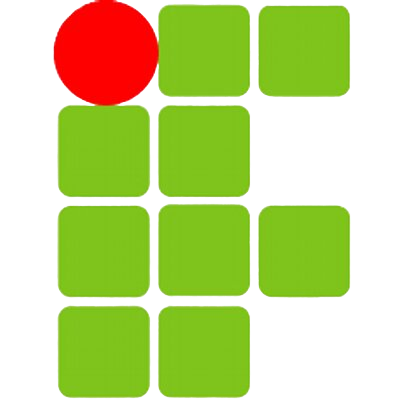

<h1 align="center">
    Oi, eu sou o Arthur!
  
</h1>

  

  

## Sobre mim

- Me chamo Arthur Sandrini.
- 📍 Sou de Cachoeiro de Itapemirim, ES.
-  Técnico em informática e atualmente cursando Sistemas de Informação no Ifes (previsão de conclusão em 2027).
- 👩🏻‍💻 Atuo como desenvolvedor Python / Dados (bolsista Fapes) no projeto **IntegraCAR**, do Ifes em parceria com o Idaf, com foco em IA aplicada e extração de documentos.
- 🚀 Fundador do **IdentMiner**, projeto aprovado no Programa Gênesis (FAPES) para identificação de rochas ornamentais por imagem.
- 🦾 Estou sempre em busca de aprendizado e evolução na área de tecnologia.

## Tecnologias e ferramentas

    &nbsp;
    &nbsp;
    &nbsp;
    &nbsp;
    &nbsp;
    &nbsp;
    &nbsp;
    &nbsp;
    &nbsp;
    &nbsp;
    &nbsp;
    &nbsp;
    &nbsp;

**Também trabalho com:** SQL, Excel, OCR, regex, ETL, Google BigQuery, Pydantic, Alembic, Poetry, APIs REST, Machine Learning, Visão Computacional, CNNs, LLMs, modelos visão-linguagem, embeddings e recuperação de imagens.

## O que venho estudando e desenvolvendo

### IntegraCAR (Ifes + Idaf)

Pipeline de IA para extração estruturada de documentos do Cadastro Ambiental Rural, combinando OCR, modelo visão-linguagem de pesos abertos, LLM, regex e validações, com processamento local de dados sensíveis.

- Em uso real no setor público: 191 processos e 7.813 páginas processados, com mediana de cerca de 2 minutos por processo em GPU de uso comum
- **93,7% de acurácia** (IC 95%: 92,5% a 94,8%), em avaliação com 19 especialistas sobre 1.751 valores
- Auditabilidade: registro da página de origem de cada valor, validação cruzada e sinalização de inconsistências para revisão humana

### IdentMiner

- Identificação de rochas ornamentais por imagem com classificador EfficientNetV2-S (97,4% de acurácia em 45 litótipos)
- Catálogo vivo de referências que absorve lotes novos sem retreinamento
- Projeto selecionado no Edital FAPES nº 09/2025 (Programa Gênesis)

### Em foco
 
- Manipulação e análise de dados com Pandas, NumPy e SQL
- Validação de dados e pipelines de ETL
- Machine Learning, visão computacional e avaliação de modelos
- OCR, LLMs e processamento de documentos
- Backend com Python e APIs

## Contato

  

   arthsandrini@gmail.com

